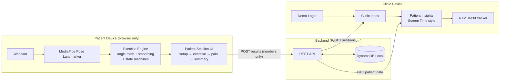
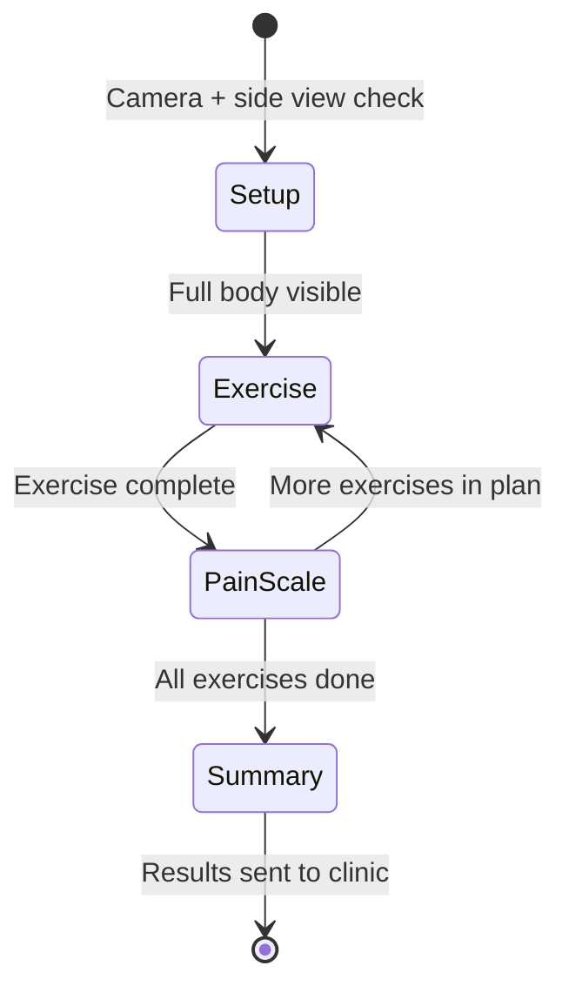

<!-- Implementation plan produced by Kiro's Plan agent (Kiro IDE) on 2026-10-24 and approved
     via switch_to_execution. Copied verbatim from the Kiro session; not edited. -->

## Implementation Plan — Rehab.io

### Problem Statement

After a PT visit, most patients don't complete their home exercises, and PTs have no visibility into what happens at home until the next visit. Rehab.io bridges this gap: patients do exercises in front of a webcam, computer vision counts reps and measures range of motion (ROM), and only the resulting numbers (never video) are sent to the clinic. The data also supports Medicare Remote Therapeutic Monitoring (RTM) billing documentation (code 98977, requiring 16+ days of data per 30-day period). The core value proposition is improved healthcare coordination: patient accountability + PT visibility + billing eligibility.

**Scope:** Phases 1-3 are the solid baseline (patient session → backend → clinic insights). Phases 4-6 are stretch. Video never leaves the patient's device. Use "monitoring" language, never "diagnosis." Patient UI targets older adults — large text, simple flow.

### Requirements (Gathered)

- Patient does webcam exercises; CV counts reps and measures ROM; only numbers are sent to clinic
- 3 exercises (pluggable): 30-Second Chair Stand Test (CDC STEADI), Squat, Shoulder Flexion Raise
- Compute angles from 3D worldLandmarks, smooth them, ignore low-visibility landmarks, count reps with state machines
- Exercise library stored as `exerciseLibrary.json` (not scraped at runtime), with sources cited
- Clinic side: inbox of completed sessions + iOS Screen Time-style patient insights (week/month toggle, big headline stat with trend, rounded per-day bar chart with dashed target line and grey stubs for missed days, summary chips, per-exercise rows with progress bars)
- RTM 16/30-day tracking indicator for billing eligibility
- Auth: simple demo-login mode (patient/clinic role), no real Cognito for now
- Storage: DynamoDB Local via Docker
- Camera: real camera only, no simulation mode
- WHOOP: dropped entirely
- Triage feature (flag high-pain / under-threshold patients): stretch after phase 3
- Seed data: 1 clinic, 1 PT, 3 patients with ~30 days realistic history, 1 unlinked patient with active invite
- **IMPORTANT INCREMENTAL APPROACH**: Build up DynamoDB table schemas over time, NOT all at once. Only create tables that are needed for the current task.

### Background (Research Findings)

**MediaPipe Pose Landmarker:**
- Package: `@mediapipe/tasks-vision`
- 33 body landmarks, outputs both normalized `landmarks` (image coordinates) and `worldLandmarks` (3D metric coordinates, centered on hips)
- Each landmark has `x`, `y`, `z`, `visibility`, `presence`
- For real-time camera: use `runningMode: "VIDEO"` and call `detectForVideo(video, timestamp)`
- Key landmarks for our exercises: shoulders (11/12), elbows (13/14), wrists (15/16), hips (23/24), knees (25/26), ankles (27/28)
- Model bundle `pose_landmarker_full.task` loaded via `FilesetResolver`

**Angle Computation:**
- Angle at a joint = angle at the vertex landmark formed by three landmarks (e.g., knee angle = angle at knee between hip→knee→ankle vectors)
- Computed via dot product / law of cosines in 3D
- Shoulder flexion = angle at shoulder between hip→shoulder→elbow (0° = arm at side, 180° = arm overhead)
- Knee angle = angle at knee between hip→knee→ankle (170-180° = extended/standing, ~90° = flexed/sitting)

**CDC STEADI 30-Second Chair Stand:**
- Protocol: seated, arms crossed, stand fully as many times as possible in 30 seconds
- Normative scores by age/sex (e.g., men 60-64: ≥14 stands, women 60-64: ≥12 stands; lower scores = higher fall risk)
- Source: CDC STEADI (Stopping Elderly Accidents, Deaths & Injuries)

**AAOS Normative ROM:**
- Shoulder flexion: ~180° normal (decreases with age)
- Knee flexion: ~135° normal
- Squat depth target: measured as minimum knee flexion angle reached

**RTM Billing (Medicare):**
- 98975: RTM initial setup + patient education (first 15 min)
- 98976: RTM device supply with initial setup (per 30 days)
- 98977: RTM device supply without initial setup, musculoskeletal (per 30 days)
- 98980/98981: Treatment management services (first 20 min / each additional 20 min per 30 days)
- Key requirement: 16+ days of monitoring data per 30-day period
- Provider must review data and interact with patient
- Our app tracks: onboarding event, per-day data transmission, PT review time, patient call logs

**Rep Counting State Machines:**
- All exercises use a 2-phase state machine (e.g., UP/DOWN)
- Rep counted on return to "home" phase (the starting position)
- Chair Stand: DOWN (seated) → UP (standing) → DOWN (rep counted)
- Squat: UP (standing) → DOWN (squatting) → UP (rep counted)
- Shoulder Flexion: DOWN (arm lowered) → UP (arm raised) → DOWN (rep counted)
- Thresholds use hysteresis (two different thresholds for up/down to prevent jitter)

### Proposed Solution

**Architecture:**



**Patient Session Flow:**



**Repo Structure:**
```
Hackachusetts-RehabPartner/
├── web/                          # React + Vite + Tailwind
│   ├── src/
│   │   ├── lib/
│   │   │   ├── exerciseLibrary.json
│   │   │   ├── angleMath.ts
│   │   │   ├── exerciseEngine.ts
│   │   │   ├── poseLandmarker.ts
│   │   │   ├── api.ts
│   │   │   └── auth.ts
│   │   ├── components/
│   │   │   ├── patient/
│   │   │   └── clinic/
│   │   ├── App.tsx
│   │   └── main.tsx
│   ├── package.json
│   ├── vite.config.ts
│   └── vitest.config.ts
├── api/                          # FastAPI + Mangum
│   ├── main.py
│   ├── routes/
│   ├── models.py
│   ├── seed.py
│   ├── dynamodb.py
│   ├── requirements.txt
│   └── pytest tests
├── docker-compose.yml            # DynamoDB Local
└── README.md
```

**DynamoDB Tables (created incrementally as needed, NOT all upfront):**

The full eventual schema is below, but tables are created ONLY when the task that needs them is reached:

| Table | PK | GSI | Key Fields | Created in Task |
|-------|-----|-----|------------|-----------------|
| `Clinics` | `clinic_id` | — | name, address | Task 2 (user tables) |
| `Providers` | `provider_id` | `clinic_id` | name, email, role: "PT" | Task 2 (user tables) |
| `Patients` | `patient_id` | `clinic_id` | name, dob, age, sex, limitations, status | Task 2 (user tables) |
| `Plans` | `plan_id` | `patient_id` | patient_id, provider_id, exercises[], approved | Task 10 (when plans needed) |
| `Sessions` | `session_id` | `patient_id`, `clinic_id` | patient_id, clinic_id, plan_id, exercises[], timestamps | Task 11 (when session results wired) |
| `Invites` | `invite_id` | `clinic_id` | patient_id, plan_id, token, expires_at, used | Task 16 (QR flow, stretch) |
| `ReviewLogs` | `log_id` | `patient_id` | patient_id, provider_id, type, duration, notes | Task 17 (review logging, stretch) |

**Session record shape (what gets sent from patient → backend):**
```json
{
  "session_id": "uuid",
  "patient_id": "p1",
  "clinic_id": "c1",
  "plan_id": "pl1",
  "started_at": "2024-01-15T10:00:00Z",
  "completed_at": "2024-01-15T10:15:00Z",
  "exercises": [
    {
      "exercise_id": "chair-stand-30s",
      "name": "30-Second Chair Stand Test",
      "reps": 12,
      "peak_rom": 168,
      "target_rom": 165,
      "form_score": 85,
      "pain": 2,
      "duration_seconds": 30
    }
  ]
}
```

**Simple Auth (demo-login mode):**
- A role switcher on a landing page: "I'm a Patient" or "I'm a Physical Therapist"
- Patient login: enter/select patient ID (later: scan QR; for now: simple selection or entry)
- Clinic/PT login: select PT provider to load the clinic dashboard
- Stored in React state + localStorage (no real tokens)
- Backend stores user info in DynamoDB (Providers table for PTs, Patients table for patients, Clinics table for clinic info)

### Task Breakdown

#### Phase 1: Exercise Library + Exercise Engine + Patient Session (Hardcoded Plan)

**Task 1: Scaffold web project + role-based landing page + FastAPI/DynamoDB user tables**

Objective: Set up the frontend project with all required dependencies, build the role-selection landing page (Physical Therapist vs Patient), AND set up the FastAPI backend with DynamoDB Local Docker running, creating ONLY the user-info tables (Clinics, Providers, Patients).

Implementation guidance:

**Frontend (web/):**
- Create Vite React TypeScript project in `web/`
- Install and configure Tailwind CSS (use `@tailwindcss/vite` plugin for Vite, or PostCSS approach — whichever is current)
- Install dependencies: `@mediapipe/tasks-vision`, `recharts`, `qrcode.react`, `react-router-dom`, `vitest`, `@testing-library/react`, `jsdom`
- Set up a basic app shell with React Router
- Create a large-text, accessible design system in Tailwind (base font 18px, large buttons, high contrast) for older adults
- Create the landing page with two large role-selection cards:
  - "I'm a Physical Therapist" — routes to a PT login/selection screen
  - "I'm a Patient" — routes to a patient login/selection screen
- For now, the PT and Patient login screens can be simple placeholders that will be wired to the backend in the next step. They should fetch user lists from the backend and let you pick a user (demo-login style).
- The PT screen fetches from `GET /providers` and shows a list of PTs to log in as
- The Patient screen fetches from `GET /patients` and shows a list of patients to log in as
- Store the selected role + user ID in localStorage via a simple auth context

**Backend (api/):**
- Create `docker-compose.yml` at repo root with `amazon/dynamodb-local` image, port 8000
- Create `api/requirements.txt`: fastapi, uvicorn, mangum, boto3, pytest, httpx
- Create `api/dynamodb.py`: DynamoDB resource pointing at `http://localhost:8000` for local dev. Table creation function that creates ONLY the three user tables for now:
  - `Clinics` (PK: `clinic_id`) — fields: clinic_id, name, address, created_at
  - `Providers` (PK: `provider_id`, GSI: `clinic_id-index`) — fields: provider_id, clinic_id, name, email, role, created_at
  - `Patients` (PK: `patient_id`, GSI: `clinic_id-index`) — fields: patient_id, clinic_id, name, dob, age, sex, limitations, status, created_at
- Create `api/main.py`: FastAPI app with CORS enabled (allow localhost:5173), Mangum handler for Lambda, `/health` endpoint, table creation on startup (if tables don't exist), and basic CRUD routes for users:
  - `GET /providers` — list all providers (optionally filter by clinic_id)
  - `GET /providers/{provider_id}` — get one provider
  - `POST /providers` — create a provider
  - `GET /patients` — list all patients (optionally filter by clinic_id)
  - `GET /patients/{patient_id}` — get one patient
  - `POST /patients` — create a patient
  - `GET /clinics` — list clinics
  - `POST /clinics` — create a clinic
- Create a small seed script `api/seed_users.py` that creates:
  - 1 clinic ("Riverside Physical Therapy")
  - 1 PT provider linked to that clinic
  - 3 patients linked to that clinic (with realistic names, DOB, sex, limitations)
  - 1 unlinked patient (status: "invited", no clinic link yet — for QR demo later)
- Create `api/test_health.py`: pytest that hits `/health` and verifies response. Also test that GET /providers and GET /patients return the seeded data.

Test requirements:
- Frontend: `cd web && npm run dev` — landing page loads with two role cards, clicking each navigates to the respective login screen
- Backend: `docker compose up -d` then `cd api && python seed_users.py` then `cd api && pytest` — health + user route tests pass
- Integration: login screens fetch user lists from the backend and display them

Demo: Open the app, see two role-selection cards. Click "I'm a Physical Therapist" → see PT login screen with the seeded PT. Click "I'm a Patient" → see patient login screen with seeded patients. Backend is running with DynamoDB Local storing the user data.

How to run after this task:
```bash
# Terminal 1: Start DynamoDB Local
docker compose up -d

# Terminal 2: Seed user data
cd api && pip install -r requirements.txt && python seed_users.py

# Terminal 3: Start backend
cd api && uvicorn main:app --reload

# Terminal 4: Start frontend
cd web && npm install && npm run dev
# Open http://localhost:5173
```

---

**Task 2: Exercise library JSON with 3 exercises + structure validation tests**

Objective: Create `exerciseLibrary.json` with complete metadata for all 3 exercises, including source citations.

Implementation guidance:
- Create `web/src/lib/exerciseLibrary.json` with three entries: `chair-stand-30s`, `squat`, `shoulder-flexion-raise`
- Each entry includes: `id`, `name`, `category`, `description`, `landmarks` (primary landmark indices + angle joint definitions), `targetRom` (metric, unit, defaults by age band and sex), `repCounting` (type, duration, state machine thresholds with hysteresis), `formCues` (id, rule, thresholds at strict/standard/lenient levels, cue text), `source` citation, and for chair stand: `normativeValues` by age/sex
- Use CDC STEADI values for chair stand, AAOS normative ROM for squat and shoulder flexion
- Write a vitest test that validates the JSON structure: every exercise has all required fields, target ROM defaults exist for age bands 60-69 / 70-79 / 80-89 for both sexes, form cue levels exist for all three strictness levels

Test requirements: `npm test` — validation tests pass.

Demo: Import the library in a test, console output confirms 3 exercises with valid metadata.

---

**Task 3: Angle math + smoothing + visibility filtering utilities with unit tests**

Objective: Build the core computational utilities for computing joint angles from MediaPipe worldLandmarks.

Implementation guidance:
- Create `web/src/lib/angleMath.ts`:
  - `angleAtLandmark(a, b, c)`: compute the angle at landmark `b` formed by vectors b→a and b→c in 3D, returns degrees (0-180). Uses dot product / law of cosines.
  - `shoulderFlexionAngle(hip, shoulder, elbow)`: wrapper that computes angle at shoulder between hip and elbow
  - `kneeAngle(hip, knee, ankle)`: wrapper for knee angle
- Create `EMASmoother` class: exponential moving average with configurable alpha (default 0.3). `update(rawValue)` returns smoothed value. Handles null/initial state.
- Create `isLandmarkVisible(landmark, threshold = 0.5)`: returns true if `landmark.visibility >= threshold`
- Create `filterLandmarks(landmarks, indices, threshold)`: returns the subset of landmarks at given indices that pass visibility check, or null if any key landmark fails

Test requirements: Vitest unit tests:
- `angleAtLandmark` with known right angle (0,0,0)-(1,0,0)-(1,1,0) = 90°
- `angleAtLandmark` with collinear points = 180°
- `EMASmoother` convergence: feed noisy input, verify smoothing reduces variance
- `isLandmarkVisible` with visibility 0.3, 0.5, 0.7 and threshold 0.5
- `filterLandmarks` with mixed visibility landmarks

Demo: Run `npm test`, all math utility tests pass.

---

**Task 4: Rep counting state machines with simulated angle sequence tests**

Objective: Build the exercise engine with per-exercise rep counting state machines that process a stream of smoothed angle values.

Implementation guidance:
- Create `web/src/lib/exerciseEngine.ts`:
  - `RepCounter` class: generic 2-phase state machine with hysteresis thresholds. Takes `homeThreshold`, `awayThreshold`, `countOnTransition` (which transition counts the rep). Processes angle values one at a time, returns `{ phase, reps, currentAngle }`.
  - `ExerciseRunner` class: ties together angle computation, smoothing, rep counting, ROM tracking, and form cue evaluation for a specific exercise config from the library. On each frame: extract relevant landmarks → check visibility → compute angle → smooth → feed to rep counter → track peak ROM → evaluate form cues. Returns a frame result: `{ reps, currentAngle, peakRom, phase, cues: [{id, text, level}] }`.
  - Factory function `createExerciseRunner(exerciseConfig, targetRom, strictness)`: builds the right runner for a given exercise from the library config.
- The runner needs to know which landmarks to use and which angle to compute based on the exercise config (the `landmarks.angleJoints` field)

Test requirements: Vitest tests with simulated angle sequences:
- Feed a squat sequence (180→90→180→90→180) and verify 2 reps, peak ROM = 90
- Feed a chair stand sequence (90→170→90→170→90) and verify 2 reps, peak ROM = 170
- Feed a shoulder sequence (10→150→10→150→10) and verify 2 reps, peak ROM = 150
- Feed noisy/jittery sequence and verify smoothing prevents false rep counts (hysteresis)
- Feed a form cue trigger (e.g., knee angle way off target) and verify cue text appears

Demo: Run `npm test`, all engine tests pass. Print a sample run showing rep counts and form cues.

---

**Task 5: MediaPipe Pose Landmarker integration + camera setup check + skeleton overlay**

Objective: Get the webcam working with MediaPipe and render a live skeleton overlay on the video feed.

Implementation guidance:
- Create `web/src/lib/poseLandmarker.ts`: async `initPoseLandmarker()` that loads the model bundle via `FilesetResolver` from the CDN, creates a `PoseLandmarker` in VIDEO mode with `numPoses: 1`. Returns the landmarker instance. Handle initialization errors gracefully.
- Create `web/src/components/patient/SessionSetup.tsx`:
  - Request camera permission via `getUserMedia`
  - Show live video preview
  - Display checklist: "Can see your full body", "Side view (not facing camera directly)" — for now, manual confirmation buttons
  - "Start Session" button (disabled until camera is active)
- Create `web/src/components/patient/SkeletonOverlay.tsx`: a canvas that renders the 33 pose landmarks and connections over the video. Draw landmarks as dots and connections as lines. Use normalized landmarks (image coordinates) for drawing, but pass worldLandmarks to the engine.
- Wire together: SessionSetup → camera → MediaPipe detectForVideo loop → SkeletonOverlay renders landmarks

Test requirements: Manual — open browser, grant camera permission, see video feed with skeleton overlay tracking body movement.

Demo: Live camera feed with skeleton overlay following the person. Instructions to run: `cd web && npm run dev`, navigate to patient flow.

---

**Task 6: Live exercise session — wire engine to camera, show reps + angle + form cues**

Objective: Build the main exercise session screen that runs the exercise engine on live pose data and displays real-time feedback.

Implementation guidance:
- Create `web/src/components/patient/ExerciseSession.tsx`:
  - Receives a hardcoded plan (array of exercises from the library with default targets for a sample patient, e.g., age 72, female)
  - For each exercise, shows: exercise name, large rep counter number, live angle gauge (a semicircular gauge or progress arc showing current angle vs. PT-approved target), current phase indicator (UP/DOWN), form cue text (appears/disappears based on engine output, large text, color-coded: green=good, yellow=warn, red=fail)
  - "Next Exercise" button appears after target reps are met (or "Skip" always available)
  - Runs the detectForVideo loop, feeds worldLandmarks to the ExerciseRunner, and updates the display each frame
  - Large, high-contrast UI for older adults
- Create `web/src/components/patient/AngleGauge.tsx`: an SVG semicircular gauge showing current angle as a filled arc, with a dashed line marking the PT-approved target. Big number showing current degrees.
- Store per-exercise results (reps, peak ROM, form score) in state to pass to the summary

Test requirements: Manual — perform exercise in front of camera, watch rep counter increment, angle gauge move, form cues appear.

Demo: Real-time exercise session with live rep counting and angle display. Instructions: same as Task 5, then follow the patient flow.

---

**Task 7: Complete patient session flow — pain scale + session summary with hardcoded plan**

Objective: Finish the patient session loop end-to-end with a hardcoded plan: setup → exercises → pain after each → summary → done.

Implementation guidance:
- Create `web/src/components/patient/PainScale.tsx`: large 0-10 scale with buttons, "How much pain did you feel during this exercise?" Show after each exercise completes. Stores pain rating per exercise.
- Create `web/src/components/patient/SessionSummary.tsx`: shows summary of all exercises in the session — per exercise: name, reps completed, peak ROM vs. target, form score, pain rating. Big "peak ROM / personal best" callout. Status indicator: PENDING → DONE.
- Wire the full flow: SessionSetup → ExerciseSession (loop over plan exercises) → PainScale after each → SessionSummary → "DONE" state (results stored in local state, ready to send to backend in Phase 2)
- Hardcode a plan: 3 exercises with default targets for a sample patient (age 72, female). Load targets from exerciseLibrary.json defaults.
- Compute form score: percentage of frames where no "fail"-level form cue was active

Test requirements: Manual — complete full session (setup → all 3 exercises with pain ratings → summary). Verify all stats are correct.

Demo: Complete patient session flow from camera check to summary screen. Instructions: `cd web && npm run dev`, select "I'm a Patient", follow the flow.

---

#### Phase 2: Backend + DynamoDB + Seed Data

**Task 8: Add Sessions table + API routes for sessions + wire session results to backend**

Objective: Add the Sessions table to DynamoDB (incremental — NOT all tables, just Sessions), implement session API routes, and connect the patient session to POST results to the backend.

Implementation guidance:
- Add `Sessions` table creation to `api/dynamodb.py` (PK: `session_id`, GSI: `patient_id-index`, GSI: `clinic_id-index`). Only this table is added now.
- Create `api/routes/sessions.py`: GET `/sessions?clinic_id=X` (list sessions for clinic inbox), GET `/sessions?patient_id=X` (list sessions for a patient), POST `/sessions` (create session record from patient), GET `/sessions/{session_id}`
- Create `web/src/lib/api.ts`: fetch wrapper with base URL configurable (default `http://localhost:8000`). Functions: `getPatients()`, `getPatient(id)`, `getProviders()`, `createSession(sessionData)`, `getSessions(clinicId)`, `getPatientSessions(patientId)`
- Modify the patient session flow: after session summary, POST results to backend (`createSession(sessionData)`). Show "Results sent to your clinic" confirmation.
- Write pytest for session routes: create a session, retrieve it by clinic and by patient.

Test requirements: `cd api && pytest` — session route tests pass. Manual — complete a session, verify it appears via API GET.

Demo: Patient completes session → results land in backend. Instructions: start backend, `npm run dev`, login as patient, complete session, then `curl localhost:8000/sessions?clinic_id=c1`.

---

**Task 9: Full seed data generation (1 clinic, 1 PT, 3 patients with 30 days history, 1 unlinked patient)**

Objective: Expand the seed script to populate sessions with ~30 days of realistic history.

Implementation guidance:
- Expand `api/seed_users.py` (or create `api/seed.py`) to also generate:
  - 3 patients each with ~30 days of session history with realistic data — ROM progression (slight improvement over time), some missed days (to test RTM 16/30 tracking), varying pain scores, varying form scores. One patient should have clearly high pain / under-threshold to support the triage stretch feature.
  - 1 unlinked patient with: a patient record (status: "invited"), an active invite (not yet used — Invites table created later in stretch phase; for now just the patient record)
  - The 16/30 day coverage should vary: patient 1 has 22/30 days (eligible), patient 2 has 14/30 days (not yet), patient 3 has 18/30 days (eligible)
- Session data should be realistic: exercises from the library, reps that vary day to day, ROM that trends slightly upward over the month, pain that varies (0-5 range mostly, one patient with occasional 7-8)
- Make script idempotent (clear existing data or use fixed IDs)

Test requirements: Run `python seed.py`, verify record counts and day coverage. Add a pytest that checks seed produces expected counts.

Demo: Run seed script, then use API to list patients and sessions. Instructions: `cd api && python seed.py`.

---

#### Phase 3: Clinic Inbox + Screen Time-Style Insights

**Task 10: Clinic inbox of completed sessions**

Objective: Build the clinic-side inbox showing completed patient sessions, wired to the backend.

Implementation guidance:
- Create `web/src/components/clinic/ClinicInbox.tsx`:
  - Fetches sessions for the clinic (`getSessions(clinicId)`)
  - Displays a list/table of completed sessions: patient name, date, exercises completed (count), key metric (avg form score or peak ROM), pain indicator
  - Sortable by date (most recent first)
  - Click a session → expands to show per-exercise details (reps, ROM vs target, form score, pain)
  - Click a patient name → navigates to Patient Insights (Task 11)
  - Large, readable layout
- Wire routing: clinic login → inbox → patient insights

Test requirements: Manual — login as clinic (PT), see inbox populated with seed data sessions. Click into a session, see details.

Demo: Clinic inbox with seed data. Instructions: start backend + seed, `npm run dev`, select "I'm a Physical Therapist", see inbox.

---

**Task 11: Patient insights — iOS Screen Time-style dashboard**

Objective: Build the Screen Time-style insights view for a selected patient, the centerpiece of the clinic experience.

Implementation guidance:
- Create `web/src/components/clinic/PatientInsights.tsx`:
  - **Week/Month toggle** at the top
  - **Big headline stat** with trend vs. last period: e.g., "Avg Shoulder Flexion: 165° ↑ 8% vs last week" — large font, trend arrow, green/red color
  - **Rounded per-day bar chart** (Recharts): one bar per day, bar height = peak ROM (or a composite metric). **Dashed target line** across the chart at the PT-approved target. **Grey stubs** for missed days (days with no session — short grey bar). Color bars based on whether they met target (green) or not (amber).
  - **Summary chips**: small rounded pills showing key stats — "Total reps: 145", "Avg form score: 87%", "Sessions this week: 5", "Avg pain: 2.1"
  - **Per-exercise rows**: for each exercise in the plan, a row showing exercise name, a progress bar (current avg ROM vs target), reps trend, and a small sparkline or bar chart. Green if meeting target, amber if close, red if far below.
  - Fetch data via `getPatientSessions(patientId)` and compute the aggregates client-side (group by day, compute trends, etc.)
  - Patient header: name, age, sex, limitations

Test requirements: Manual — select a patient from the inbox, see the insights dashboard with charts and stats from 30 days of seed data.

Demo: Screen Time-style patient insights. Instructions: login as clinic, click a patient, see the dashboard.

---

**Task 12: RTM 16/30-day eligibility indicator in patient insights**

Objective: Add the RTM billing eligibility tracker — the key differentiator for the billing story.

Implementation guidance:
- Add an RTM section to `PatientInsights.tsx`:
  - **RTM eligibility badge**: prominently displayed. "16/30 days — RTM eligible ✓" (green) or "14/30 days — 2 more days needed" (amber)
  - **30-day calendar strip**: small rounded squares, one per day, filled (green/amber based on whether target was met) or grey (missed). Shows at a glance which days had data.
  - **Billing summary**: shows the data needed for code 98977 — "Onboarding: completed", "Days monitored: 16/30", "Provider reviews: 4", "Patient interactions: 1 call logged", "Total review time: 45 min"
  - Compute from sessions (days with at least one session = monitored day)
  - This is the feature that makes judges understand the billing value prop

Test requirements: Manual — view patient insights, see RTM badge with correct day count. Verify different patients show different eligibility (patient 1: eligible, patient 2: not yet).

Demo: RTM eligibility indicator with 30-day calendar strip. Instructions: same as Task 11, check the RTM section.

---

#### Phase 4 (Stretch): PT Plan Creation + Target Approval + QR Join Flow

**Task 13: Add Plans table + PT plan creation UI + target approval with sliders + SVG stick figure**

Objective: Add the Plans table to DynamoDB (incremental), and let the PT create a patient, pick exercises from the library, adjust targets with sliders, and approve the plan.

Implementation guidance:
- Add `Plans` table to `api/dynamodb.py` (PK: `plan_id`, GSI: `patient_id-index`). Only this table added now.
- Create `api/routes/plans.py`: GET `/plans/{plan_id}`, GET `/plans?patient_id=X`, POST `/plans`, PUT `/plans/{plan_id}/approve`
- Create `web/src/components/clinic/PlanCreation.tsx`:
  - Patient creation form: name, DOB, age (auto-computed), sex, limitations
  - Exercise picker: list from exerciseLibrary.json with checkboxes. Selected exercises populate with default target ROM and strictness pre-filled from the library (based on patient age/sex)
  - Per-exercise target adjustment: sliders for target ROM and form-cue strictness. A simple SVG stick figure that visually shows the angle. Update the stick figure as the slider moves.
  - "Approve Targets" button — must be clicked before plan activates. Shows "APPROVED" state after.
  - On approval, POST the plan to the backend

Test requirements: Manual — create a patient, pick exercises, adjust targets, see stick figure update, approve plan. Pytest for plan routes.

Demo: PT creates and approves a plan.

---

**Task 14: Add Invites table + QR handout generation + patient QR join flow**

Objective: Generate a printable handout with a signed QR code for the patient to scan and join.

Implementation guidance:
- Add `Invites` table to DynamoDB (PK: `invite_id`, GSI: `clinic_id-index`). Only this table added now.
- Create `api/routes/invites.py`: POST `/invites` creates an invite record with a signed token + expiry. GET `/invites/{token}` validates and returns invite info.
- Create `web/src/components/clinic/QrHandout.tsx`: after plan approval, show a printable handout (print-friendly CSS) with clinic name, patient name, plan summary, and a QR code (using `qrcode.react`) encoding a join link URL. "Print" button.
- Create `web/src/components/patient/JoinFlow.tsx`: patient scans QR → enters DOB to verify → creates account (demo: just confirm) → consents to share data with clinic → plan schedule fills in. Log onboarding event.
- Wire: the joined patient now has a plan and appears in the clinic inbox

Test requirements: Manual — approve a plan, see QR handout, open the join URL, complete join flow, verify patient appears in inbox.

Demo: PT approves plan → generates QR → patient joins via QR.

---

#### Phase 5 (Stretch): RTM Report + Review Logging

**Task 15: Add ReviewLogs table + review time logging + log patient call + printable RTM report**

Objective: Add review-time logging, patient call logging, and a printable RTM report.

Implementation guidance:
- Add `ReviewLogs` table to DynamoDB (PK: `log_id`, GSI: `patient_id-index`). Only this table added now.
- Create `api/routes/reviews.py`: GET `/reviews?patient_id=X`, POST `/reviews` (log a review or patient call)
- Create `web/src/components/clinic/ReviewLog.tsx`: a "Start Review" timer (tracks minutes), and a "Log Patient Call" button (records call with notes + duration). Both POST to backend.
- Create `web/src/components/clinic/RTMReport.tsx`: a printable monthly RTM report (print-friendly) containing: patient info, plan of care, 30-day monitoring summary, per-exercise summary, review time log, patient interactions, Bedrock progress note (Task 16 — placeholder for now), "Print Report" button.

Test requirements: Manual — log a review, log a call, generate RTM report, verify it includes all sections.

Demo: PT reviews patient data, logs time, logs a call, prints RTM report.

---

#### Phase 6 (Stretch): Bedrock + Cognito + Deploy

**Task 16: Bedrock (Claude) progress note generation**

Objective: Generate a clinical progress note from session data using AWS Bedrock (Claude).

Implementation guidance:
- Add Bedrock client to backend. Create `POST /patients/{id}/progress-note` endpoint that fetches patient session data, constructs a prompt with aggregated stats, calls Bedrock Claude to generate a SOAP-format progress note. Returns note text.
- Wire into the RTM report: "Generate Progress Note" button calls the endpoint and fills in the note section.
- If Bedrock is not available (no AWS credentials in dev), fall back to a template-based note generator.
- Use "monitoring" language, never "diagnosis".

Test requirements: Manual — generate a progress note, verify it reads as a clinical summary. Fallback template works without AWS credentials.

Demo: PT clicks "Generate Progress Note" in the RTM report, sees a Claude-generated clinical note.

---

**Task 17: Cognito auth + Lambda deploy (Mangum) + Amplify deploy**

Objective: Replace demo-login with real Cognito auth and deploy to AWS.

Implementation guidance:
- Set up Cognito user pool with patient and clinic groups (roles via group claims)
- Replace `web/src/lib/auth.ts` demo-login with Cognito auth
- Add JWT validation middleware to FastAPI (verify Cognito tokens)
- Package API as Lambda with Mangum handler, deploy via SAM/Serverless
- Deploy frontend via AWS Amplify (connect repo, set build command)
- Update API base URL in frontend to point to Lambda function URL

Test requirements: Manual — login via Cognito on the deployed app, complete a session, see it in the clinic dashboard.

Demo: Live deployed app at an Amplify URL.

---

### How to Run After Each Phase

| Phase | How to run |
|-------|-----------|
| 1 | `docker compose up -d` → `cd api && python seed_users.py && uvicorn main:app --reload` → `cd web && npm install && npm run dev` → select role → patient does webcam exercises, results stored locally |
| 2 | Same + seed full history → patient session now POSTs results to backend |
| 3 | Same → login as PT → inbox + Screen Time insights + RTM badge |
| 4 | Same + "Create New Plan" in clinic view → print QR → join via URL |
| 5 | Same + review logging + RTM report |
| 6 | Deploy commands (TBD based on AWS setup) |
